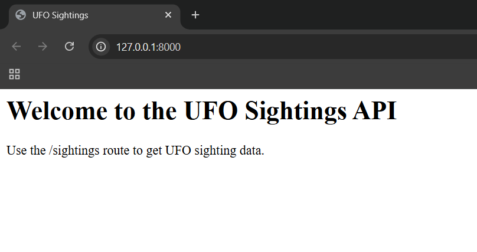
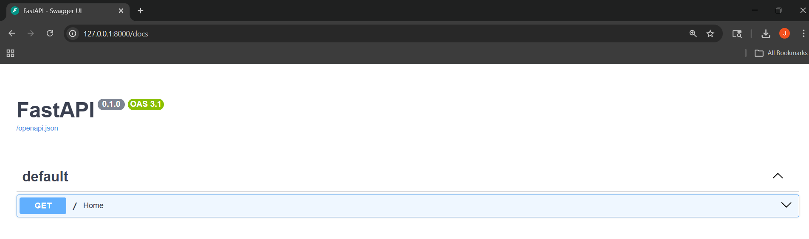
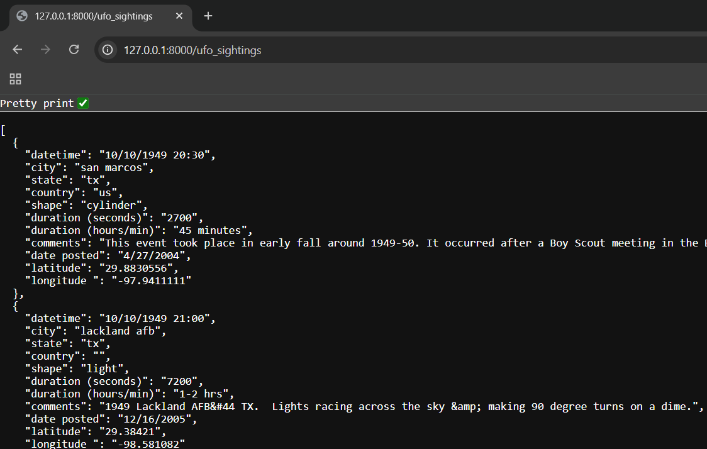

# FastAPI Fundamentals

## What is a Web API?

A **Web API** (Application Programming Interface) is a way for programs to talk to each other over the internet, usually using HTTP, the same protocol your browser uses to load websites.

Instead of returning an HTML page meant to be looked at by a person, a Web API usually returns **data** (most often in JSON format) meant to be read by another program. For example, a weather app on your phone doesn't host the weather data itself. It asks a Web API like `https://api.weather.gov/forecast?city=edmonton` and gets back a JSON "response" with the forecast, then displays it however it wants.

Web APIs are built around a few key ideas:

- **Endpoints** (also called "routes") are the designated URLs that do specific things. In the example above, the URL is used to get the weather forecast for the city of Edmonton.
- **HTTP methods** are the "verb" attached to a request. `GET` reads data, `POST` creates new data, `PUT`/`PATCH` updates existing data, `DELETE` removes data.
- **Request and response** — the client (website) sends a request to an endpoint, "requesting" it to perform a specific task (see the HTTP methods). The server takes that request, attempts to perform the action, then sends back a "response" usually in the form of JSON including a status code like `200 OK` or `404 Not Found`.

In this lesson, we'll build our own Web API in Python using FastAPI.

## Why is this important?

FastAPI is a modern, high-performance Python web framework for building APIs. It's one of the most popular frameworks in the Python ecosystem today.

A few things that make FastAPI a great first framework to learn:

- It's built around standard Python **type hints**, so the API you write is also includes some documentation out of the box.
- It **automatically generates interactive API documentation** for you. No extra setup required. This will allow us to test the functionality of our web API.
- It validates incoming data automatically, so you write less boilerplate code.
- It's fast both in terms of runtime performance and developer productivity.

This knowledge pairs really well with your frontend skills (HTML, CSS, JavaScript) to create full-stack web applications.

## What are we going to do?

We're going to create a simple Web API that returns data about UFO sightings. We'll create routes that serve UFO sighting data and read that data from a CSV file.

[FastAPI Docs](https://fastapi.tiangolo.com/)

[Source for data](https://www.kaggle.com/datasets/NUFORC/ufo-sightings)

## Steps

### 1. Create a virtual environment and install FastAPI
1. Create the virtual environment, and activate it:
```bash
python -m venv ./venv
.\venv\Scripts\activate # Or source ./venv/bin/activate on macOS/Linux
```
2. Install FastAPI with the standard extras (this bundles the `uvicorn` server and the `fastapi` CLI tool):
```bash
pip install "fastapi[standard]"
```
3. Save the dependencies to a requirements file:
```bash
pip freeze > requirements.txt
```

### 2. Create a simple FastAPI application

1. To create a simple FastAPI application, create a new file called `ufo_app.py` and add the following code:
```python
from fastapi import FastAPI
from fastapi.responses import HTMLResponse

app = FastAPI()
```
- This code imports the `FastAPI` class and creates an instance of it.
- We also import `HTMLResponse`, which we'll use in the next step to return an HTML page instead of JSON.

2. We can create a page that returns a simple HTML message by adding the following code to `ufo_app.py`:
```python
@app.get("/", response_class=HTMLResponse)
def home() -> str:
    return """
    <html>
        <head>
            <title>UFO Sightings</title>
        </head>
        <body>
            <h1>Welcome to the UFO Sightings API</h1>
            <p>Use the /sightings route to get UFO sighting data.</p>
        </body>
    </html>
    """
```
- `@app.get("/")` registers a route (endpoint) that responds to `GET` requests at the URL `/`.
- `response_class=HTMLResponse` tells FastAPI to return the string as HTML. By default, FastAPI returns JSON for everything — so without this override, the HTML string would come back wrapped in JSON quotes.

### 3. Let's run the application

There are a couple of different ways to run a FastAPI application.

**Option 1 (recommended): the `fastapi` CLI**
```bash
fastapi dev ufo_app.py
```
- `fastapi dev` is the development command — it watches your files and automatically reloads the server when you make changes.

**Option 2: run `uvicorn` directly**
```bash
uvicorn ufo_app:app --reload
```
- Under the hood, `fastapi dev` is using `uvicorn` (an ASGI web server) to actually run your app. Knowing this is useful when deploying to production, where you'd typically invoke `uvicorn` directly.
- The `ufo_app:app` syntax tells uvicorn to look in the `ufo_app.py` file for an object named `app`.

The output of `fastapi dev` should look something like this:
```
$ fastapi dev ufo_app.py
INFO     Using path ufo_app.py
INFO     Resolved absolute path /your/path/ufo_app.py
INFO     Searching for package file structure from directories with __init__.py files
INFO     Importing module ufo_app

         ╭─────────── FastAPI CLI - Development mode ───────────╮
         │                                                      │
         │  Serving at: http://127.0.0.1:8000                   │
         │                                                      │
         │  API docs: http://127.0.0.1:8000/docs                │
         │                                                      │
         │  Running in development mode, for production use:    │
         │                                                      │
         │  fastapi run                                          │
         │                                                      │
         ╰──────────────────────────────────────────────────────╯
```

Note: just like with Jupyter notebooks, the server will keep running in your terminal until you stop it (Ctrl+C). The default port is **8000**.

You can now open your web browser and go to [`http://127.0.0.1:8000`](http://127.0.0.1:8000/) to see the home page of your application.

When you open the link you should see something like this:



You've just created and run your first FastAPI application. Woo!

**Bonus: free interactive docs**

Before we go any further, visit [`http://127.0.0.1:8000/docs`](http://127.0.0.1:8000/docs) in your browser. FastAPI automatically generates an interactive documentation page for every route in your app — no setup required. You can even try out your routes directly from this page.



We'll dig deeper into what this page can do in a later lesson when we add Pydantic models, but it's worth noticing now.

### 4. Create a route to return UFO sighting data from a CSV file

1. Let's use the `csv` module to read the `data/scrubbed.csv` file and load the data into our application. First, import the `csv` module at the top of `ufo_app.py`:
```python
import csv
```

2. Next, create a function to read the CSV file and load the data into a list of dictionaries. Add the following code to `ufo_app.py`:
```python
def load_ufo_data(filepath: str) -> list[dict]:
    sightings = []
    with open(filepath, mode="r", encoding="utf-8") as file:
        csv_reader = csv.DictReader(file)
        for row in csv_reader:
            sightings.append(row)
    return sightings
```
- This should look familiar from the file-reading lessons — `csv.DictReader` gives us each row as a dictionary keyed by the column headers.

3. Now create a new route that returns the UFO sighting data:
```python
@app.get("/ufo_sightings")
def get_sightings() -> list[dict]:
    return load_ufo_data("data/scrubbed.csv")
```
- `@app.get("/ufo_sightings")` registers a `GET` route at `/ufo_sightings`.
- Notice we're returning a plain Python `list[dict]`. JSON is FastAPI's default response type, it automatically serializes (converts) the list and the dictionaries inside it to JSON for you. The `-> list[dict]` type hint also tells FastAPI and the auto-generated documentation what shape to expect.

4. Restart your server if it isn't already reloading, and go to [`http://127.0.0.1:8000/ufo_sightings`](http://127.0.0.1:8000/ufo_sightings).

Your browser should display all of the UFO sighting data from the CSV file in JSON format!



Note: this may take a few seconds to load since there is a lot of data.

You might be thinking "wow this is a lot of data to send at once". You're right! In a real application you would want to implement pagination ("pages") to limit the amount of data sent at once. We'll add that in the next lesson.

## Exercises

1. Add a new route that returns all of the UFO sightings from the `data/complete.csv` file.

2. Add a new route that returns the first ten results from the `data/scrubbed.csv` file.

## Summary

This lesson introduced you to FastAPI, a modern Python web framework for building Web APIs. You learned what a Web API is, how to create a simple FastAPI application, how to run it with the `fastapi` CLI (and what's happening under the hood with uvicorn), and how to read data from a CSV file and return it as JSON. You also got a sneak peek at FastAPI's auto-generated interactive docs at `/docs`.
