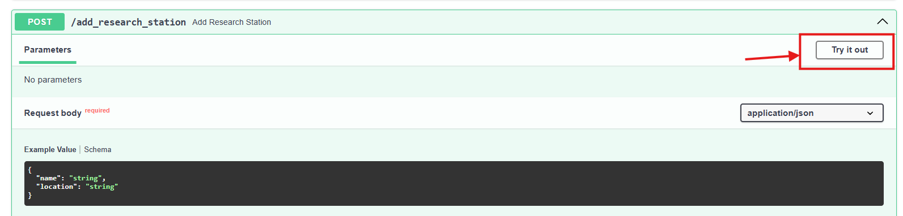
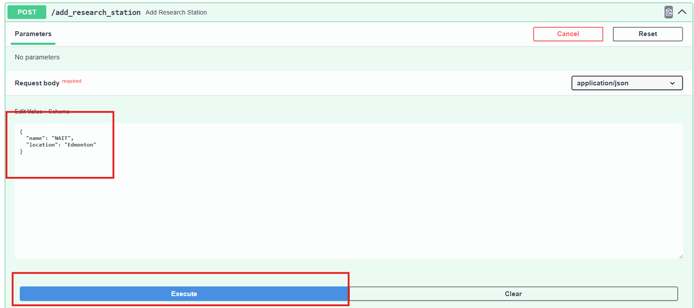
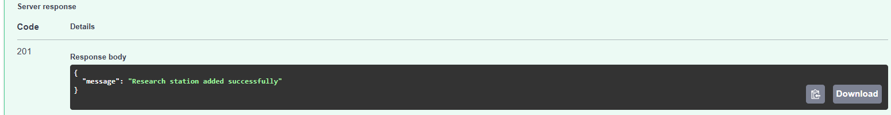

# FastAPI with Query Parameters and POST Requests

## Why is this important?

In the last lesson we built a Web API that returned the same data on every request. Real APIs need to respond to what the user is asking for, such as filtering results, paginating them, and accepting new data from the client.

In this lesson we'll extend our UFO sightings API to:

- Accept **query parameters** from the URL (e.g., `?country=ca&page=2`).
- Paginate large result sets.
- Accept **POST** requests so users can add new data to a CSV file.

We'll also see the auto-generated `/docs` page in action. It can call our endpoints for us, including POST requests, without any extra tools.

## What are we going to do?

We're going to take the UFO sightings API from the last lesson and:

1. Add a `country` filter to the `/ufo_sightings` endpoint.
2. Add `page` and `per_page` query parameters for pagination.
3. Add a `/research_stations` endpoint that reads from a different CSV file.
4. Add an `/add_research_station` POST endpoint that appends new data to that CSV.

[FastAPI Docs](https://fastapi.tiangolo.com/)

[Query Parameters](https://fastapi.tiangolo.com/tutorial/query-params/) — how function parameters become query params

[Body — Singular values in body](https://fastapi.tiangolo.com/tutorial/body-multiple-params/#singular-values-in-body) — how to declare individual JSON body fields with `Body(...)`

[Handling Errors with `HTTPException`](https://fastapi.tiangolo.com/tutorial/handling-errors/) — how to return error responses

[Postman](https://www.postman.com/downloads/) — a tool for testing APIs

## Steps

### 1. Recap: virtual environment, install, and run

1. Create the virtual environment, and activate it:
```bash
python -m venv ./venv
.\venv\Scripts\activate # Or source ./venv/bin/activate on macOS/Linux
```
2. Install FastAPI with the standard extras:
```bash
pip install "fastapi[standard]"
```
3. Save the dependencies to a requirements file:
```bash
pip freeze > requirements.txt
```
4. Run the application:
```bash
fastapi dev ufo_app.py
```
- `fastapi dev` watches your files and automatically reloads the server when you make changes — useful while we add new routes.

### 2. Add a `country` query parameter (with `breakpoint()` for debugging)

**Query parameters** are key/value pairs tacked onto the end of a URL after a `?`, separated by `&` if there's more than one — for example, `?country=ca&page=2`. They're how clients tell the server *what they want*: filter criteria, page numbers, sort options, and so on.

In FastAPI, **any function parameter that isn't part of the URL path is automatically treated as a query parameter**. We can use a regular Python default value to make it optional.

1. Open the `ufo_app.py` file and modify the `get_sightings` function. Add a `country` parameter with a default of `""`, and a `breakpoint()` for debugging:
```python
import csv
from fastapi import FastAPI
from fastapi.responses import HTMLResponse

app = FastAPI()

# ... existing code ...

@app.get("/ufo_sightings")
def get_sightings(country: str = "") -> list[dict]:
    breakpoint()
    sightings = load_ufo_data("data/scrubbed.csv")
    return sightings
```
- `country: str = ""` tells FastAPI: "accept an optional query parameter named `country`, treat it as a string, and use an empty string if it's missing."
- `breakpoint()` pauses execution so we can inspect variables in the terminal — useful for understanding what FastAPI hands us.

2. With the server running, navigate to [http://127.0.0.1:8000/ufo_sightings?country=ca](http://127.0.0.1:8000/ufo_sightings?country=ca).
- Your terminal will pause at the breakpoint. You can inspect the variable:
```
(Pdb) country
'ca'
(Pdb) type(country)
<class 'str'>
(Pdb) continue
```
- Type `continue` (or `c`) to let the request finish.

### 3. Filter the sightings by country

Now let's actually use the `country` parameter. Remove the `breakpoint()` and add a filter:
```python
@app.get("/ufo_sightings")
def get_sightings(country: str = "") -> list[dict]:
    sightings = load_ufo_data("data/scrubbed.csv")
    if country:
        sightings = [sighting for sighting in sightings if sighting["country"].lower() == country.lower()]
    return sightings
```
- If `country` is the empty string (default), we return everything.
- Otherwise we keep only sightings where the country matches (case-insensitively).

Test it by navigating to [http://127.0.0.1:8000/ufo_sightings?country=ca](http://127.0.0.1:8000/ufo_sightings?country=ca). You should now see only the Canadian sightings.

### 4. Add pagination with `page` and `per_page`

That's still a lot of data to send back at once. Let's add **pagination**, the term used for splitting a large result set into smaller chunks ("pages") and serving them one page at a time. This keeps responses fast and lets clients ask for only the slice of data they need, which matters for any API that returns more than a handful of records.

Add two more query parameters to the route:
```python
@app.get("/ufo_sightings")
def get_sightings(
    country: str = "",
    page: int = 1,
    per_page: int = 10,
) -> list[dict]:
    sightings = load_ufo_data("data/scrubbed.csv")
    if country:
        sightings = [s for s in sightings if s["country"].lower() == country.lower()]
    start = (page - 1) * per_page
    end = start + per_page
    return sightings[start:end]
```
- `page: int = 1` and `per_page: int = 10` are query parameters typed as integers. URL values are always strings, but because we typed these as `int`, **FastAPI converts them for us** and returns a helpful error if someone passes a non-number. This is the type hint earning its keep: we never have to write `int(...)` ourselves or validate the input.
- We slice the list to return only the page the user asked for.

Test it by navigating to [http://127.0.0.1:8000/ufo_sightings?country=ca&page=2&per_page=5](http://127.0.0.1:8000/ufo_sightings?country=ca&page=2&per_page=5) — you'll see only 5 results from the second page of Canadian sightings.

### 5. Create a `/research_stations` GET endpoint

Let's add a new endpoint that lists research stations from a different CSV file. Add this route to `ufo_app.py`:
```python
@app.get("/research_stations")
def get_research_stations() -> list[dict]:
    stations = []
    with open("data/research_stations.csv", mode="r", encoding="utf-8") as file:
        csv_reader = csv.DictReader(file)
        for row in csv_reader:
            stations.append(row)
    return stations
```
Test it by navigating to [http://127.0.0.1:8000/research_stations](http://127.0.0.1:8000/research_stations).

### 6. Add a POST endpoint with `Body(...)` and `HTTPException`

So far our routes have only read data. Let's add an endpoint that lets users *add* a new research station by POSTing JSON data.

1. Update your imports at the top of `ufo_app.py` to include `Body` and `HTTPException`:
```python
from fastapi import FastAPI, Body, HTTPException
```

2. Add the POST route:
```python
@app.post("/add_research_station", status_code=201)
def add_research_station(
    name: str = Body(...),
    location: str = Body(...),
) -> dict:
    if not name or not location:
        raise HTTPException(status_code=400, detail="Name and location are required")
    with open("data/research_stations.csv", mode="a", newline="", encoding="utf-8") as file:
        fieldnames = ["name", "location"]
        writer = csv.DictWriter(file, fieldnames=fieldnames)
        writer.writerow({"name": name, "location": location})
    return {"message": "Research station added successfully"}
```

There's a lot going on here — let's unpack it:

- **`@app.post(...)`** — registers a route that responds to `POST` requests instead of `GET`.
- **`status_code=201`** — the success status code. `201 Created` is the conventional response when a new resource is added (see [HTTP status codes](https://developer.mozilla.org/en-US/docs/Web/HTTP/Status)).
- **`name: str = Body(...)` / `location: str = Body(...)`** — each field of the JSON body is declared as a function parameter using [`Body(...)`](https://fastapi.tiangolo.com/tutorial/body-multiple-params/#singular-values-in-body). The `...` means "this field is required." If the client sends a request without it, or with the wrong type, FastAPI returns a 422 error automatically, which means we don't have to write extra validation code.
- **`raise HTTPException(status_code=400, detail="...")`** — if the field is present but empty (e.g., `""`), we manually raise an [`HTTPException`](https://fastapi.tiangolo.com/tutorial/handling-errors/). FastAPI converts it into a proper JSON error response with the status code we asked for.

3. Test the POST endpoint. POST requests can't be sent from a browser URL, so we'll use FastAPI's built-in `/docs` page. Navigate to [http://127.0.0.1:8000/docs](http://127.0.0.1:8000/docs) and you should see all your routes listed. Click the green `POST /add_research_station` row, then **Try it out**, fill in the JSON body with a new name and location, and click **Execute**.





If you prefer [Postman](https://www.postman.com/downloads/), that works too — point it at `http://127.0.0.1:8000/add_research_station` with method `POST` and the same JSON body.

After executing the request, re-fetch `/research_stations` and you should see the new entry. The `data/research_stations.csv` file will now look something like:
```csv
name,location
Aerial Phenomena Research Lab,Nevada USA
Deep Space Materials Institute,Alberta Canada
Dan's alien research lab,Alberta Canada
NAIT,Edmonton
```

**Looking ahead:** declaring two `Body(...)` parameters is fine for a couple of fields, but it gets repetitive as the body grows. In the next lesson we'll see how **Pydantic models** let us describe the entire body with a single class — and we get even better validation and `/docs` for free.

## Exercises

1. Extend the `/ufo_sightings` endpoint to allow filtering by `shape` in addition to `country`.
2. Create a new `/space_organizations` GET endpoint that reads from `data/space_organizations.csv` and supports pagination.
3. Create a new POST endpoint that adds a space organization to `data/space_organizations.csv`. Use `Body(...)` for the fields and `HTTPException` for invalid input.

## Summary

In this lesson you learned how to:

- Accept query parameters in FastAPI by adding typed function parameters with default values.
- Use `breakpoint()` to inspect what FastAPI hands you at runtime.
- Filter and paginate data based on those parameters.
- Accept `POST` requests with JSON bodies using `Body(...)`.
- Return error responses with `HTTPException`.
- Use the auto-generated `/docs` page to test POST endpoints without a separate tool.

These are the building blocks of every real-world Web API.
